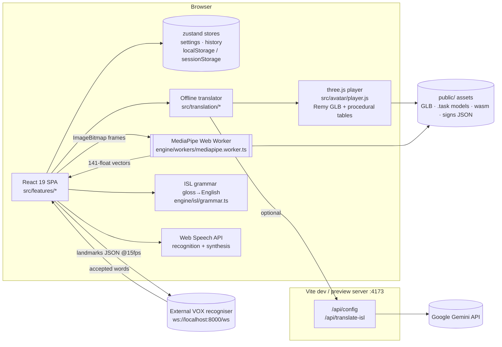

# Architecture

> Historical teammate-branch snapshot. For the integrated setup and current behavior, read [README](../../README.md) and [CLAUDE.md](../../CLAUDE.md). The integrated app uses the bundled FastAPI backend, the Ch22 avatar, raw hand-only recognition vectors, and separate opt-in body anchors for Learn. Earlier external-VOX, Remy, test-count and recognition-quality statements below may be outdated.

## Shape of the system

Parlance is a **client-heavy SPA**. Everything except two optional integrations runs in the browser:

1. **Gemini translation** — optional, through a Vite middleware (`server/translationApi.js`) that only exists while `vite` (dev) or `vite preview` is running. With no `GEMINI_API_KEY`, the browser uses its offline rule engine.
2. **ISL recognition** — required for Sign → Text, provided by an **external** WebSocket service (VOX FastAPI backend, default `ws://localhost:8000/ws`). Not in this repo.



## Directory structure (source only)

```
index.html                 SPA entry; loads /src/main.tsx
vite.config.ts             React + Tailwind plugins, mounts server/translationApi as middleware,
                           @ alias → src, port 4173 (PARLANCE_PORT), host 127.0.0.1, three.js chunk
scripts/copy-assets.mjs    predev/prebuild: copies MediaPipe wasm → public/mediapipe/wasm (gitignored)
server/
  translationApi.js        connect-style middleware: GET /api/config, POST /api/translate-isl
  translationPrompt.js     Gemini system prompt, embeds SUPPORTED_TOKENS
  apiGuard.js              body-size cap, fixed-window rate limiter, concurrency cap
src/
  main.tsx                 createRoot + RouterProvider
  app/                     router.tsx (lazy routes), RootLayout, AppShell, Preferences, RouteError, PageLoader
  features/
    landing/               LandingPage, Hero, HeroStage (live avatar), HowItWorks(+Visuals), FlowStrip,
                           WhyItMatters, About, HandTrace, Reveal, intro/ (IntroScene, SigningHands, introState)
    speech-to-sign/        SpeechToSignPage, SignerStage, ConversationPanel, phrases
    sign-to-text/          SignToTextPage, CameraStage, FramingGuide, RecognitionReadout, SentencePanel
    learn/                 Learn hub, units, lesson player, review, sign library, practice panel (see LEARN.md)
    history/ settings/ help/ shared/ NotFoundPage.tsx
  components/
    avatar/AvatarViewport.tsx   React wrapper around createAvatar()
    layout/                     SiteHeader/Footer, AppHeader, MobileTabBar, AccessibilityMenu, Logo, SkipLink…
    ui/                         Button, Card, Dialog, Switch, Segmented, Select, Toaster(announce), Status…
    brand/Arcs.tsx
  avatar/                  player.js, poseMotion.js, schedule.js, signQueue.js, playback.ts (+ .d.ts)
    animations/            words.js (index), Words/*.js (20 files), Alphabets/A–Z.js, numbers.js, defaultPose.js
  translation/             islTranslator.js, textToGloss.js, hindiToGloss.js, glossDictionary.js,
                           islVocabulary.js, liveSpeech.js (unused) (+ hand-written .d.ts)
  engine/
    workers/mediapipe.worker.ts   detection worker
    tracking.ts                   OneEuro FrameSmoother, HandAssigner, assembleFrame, MotionEnergy…
    landmarks.ts                  141-float contract constants (+ buildFrameVector, unused at runtime)
    isl/grammar.ts                toGloss (unused) / toEnglish (used by Sign → Text)
    isl/vocabulary.generated.ts   239-gloss vocabulary (generated from absent ml/vocabulary.py)
    avatar/signMotion.ts          ISLRTC landmark motion loader (landing illustrations)
    avatar/nonManual.ts           face-marker data (only consumed by grammar.toGloss → unused)
    (core/humanoid.ts, core/math.ts, tracking/handConditioner.ts were removed 2026-11-20: unused)
  learn/                   pure Learn logic: curriculum, lessonPlan, srs, motion (practice comparison) — see LEARN.md
  services/                camera/useCameraTracking, recognition/useRecognitionService,
                           speech/useSpeechInput, speech/useSpeechOutput,
                           signs/library, signs/prepareSpeech, signs/useSignQueue
  stores/                  settings.ts, history.ts
  hooks/                   useDocumentTitle, useFullscreen, useHashScroll, useInView, useMediaQuery,
                           useReducedMotion, useScrollSpy
  lib/                     cn, id, storage (never-throw Web Storage), time
  styles/index.css         Tailwind v4 @theme tokens, keyframes, text-size & motion attributes
public/
  assets/remy.glb (5.4 MB, rendered) · ybot.glb (2.1 MB, test reference rig only)
  models/hand_landmarker.task (7.5 MB) · pose_landmarker_lite.task (5.5 MB)
  signs/manifest.json (239 entries) · recognition.json (model metrics) ·
        hello/pain/welcome/where.json (only 4 motion files shipped)
test/signing.test.js
```

## Component responsibilities & boundaries

| Boundary | Contract | Owner files |
|---|---|---|
| UI ↔ avatar | `AvatarPlayer` (`setQueue`, `setOptions`, `play/toggle/restart/step`, `dispose`); `QueueItem {gloss,label,missing}`; `PlayerState` callbacks | `src/avatar/player.d.ts`, `playback.ts`, `components/avatar/AvatarViewport.tsx` |
| Text ↔ gloss | `translateOffline(text)` / `translateToGloss(text, signal)` → `{tokens, glossText, mode, skipped?}`; tokens ∈ `SUPPORTED_TOKENS` ∪ fingerspell (`A-M-I-T`, `1-1-2`) | `src/translation/islTranslator.js`, `islVocabulary.js` |
| Gloss ↔ animation | Uppercase token → export in `animations/words.js`; else per-character `alphabets`/`NUMBER_ANIMATIONS` | `src/avatar/schedule.js` |
| Browser ↔ Gemini | `POST /api/translate-isl {text}` → `{tokens}`; `GET /api/config` → `{online}` | `server/translationApi.js` |
| Main thread ↔ worker | `WorkerInMessage` (`init/frame/reset/close`), `WorkerOutMessage` (`ready/result/error`) | `engine/workers/mediapipe.worker.ts` |
| Browser ↔ recogniser | WS JSON: send `{landmarks:number[141]}`, `{config:{confidence_threshold}}`; receive `{word,confidence}` / `{status:"listening",candidate…}` / `{buffered,needed}` / `{status:"no-model"}` / `{error}` | `services/recognition/useRecognitionService.ts`, `engine/landmarks.ts` |
| Recogniser ↔ training | 141-float layout must mirror absent `ml/collect.py`; MediaPipe `.task` files "must be byte-identical" to training | `engine/landmarks.ts`, `scripts/copy-assets.mjs` comment |

## Two vocabularies (important)

| Vocabulary | Format | Size | Used by |
|---|---|---|---|
| Avatar tokens `SUPPORTED_TOKENS` | `UPPER_SNAKE` (`THANK_YOU`) | 164 | translator, Gemini prompt, avatar, Help page |
| ISLRTC / recogniser glosses | `lowercase` concatenated (`thankyou`) | 239 in manifest / 242 classes | sign library labels, recognition metrics, grammar `toEnglish` |

They are not mapped to each other. Speech → Sign never uses the ISLRTC library; Sign → Text never uses the avatar vocabulary.

## Important configuration

| File / var | Purpose |
|---|---|
| `.env` (`GEMINI_API_KEY`, `GEMINI_MODEL`) | read by Node at Vite start via `--env-file-if-exists=.env` |
| `PARLANCE_PORT` | dev/preview port (default 4173, `strictPort`) |
| `VITE_PARLANCE_WS` | build-time default recogniser URL (not in `.env.example`) |
| `localStorage["parlance.settings.v1"]` | all user settings incl. `serviceUrl`, `confidenceThreshold` (0.85) |
| `parlance.history.v1` | history in session- or localStorage depending on retention |
| `tsconfig.app.json` | strict, `noUnusedLocals/Parameters`, `erasableSyntaxOnly`, includes all of `src/` |

## Code-splitting

Every route is a lazy chunk (`src/app/router.tsx`). three.js is a manual chunk. The landing page never loads MediaPipe; the camera workspace never loads landing illustrations. The `prepareSpeech` chunk (~460 kB raw) carries all animation tables.
