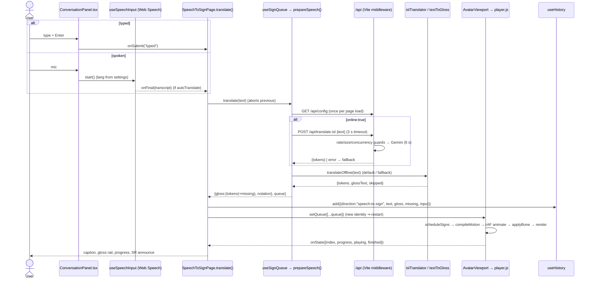

# Data Flow

> Historical teammate-branch snapshot. For the integrated setup and current behavior, read [README](../../README.md) and [CLAUDE.md](../../CLAUDE.md). The integrated app uses the bundled FastAPI backend, the Ch22 avatar, raw hand-only recognition vectors, and separate opt-in body anchors for Learn. Earlier external-VOX, Remy, test-count and recognition-quality statements below may be outdated.

## A. Typed/spoken text → ISL avatar (Speech → Sign) — working, verified (typed)



Key code: `src/features/speech-to-sign/SpeechToSignPage.tsx:41` (`translate`), `src/services/signs/prepareSpeech.ts:23`, `src/translation/islTranslator.js:22,52`, `src/translation/textToGloss.js` (`textToGloss`), `src/avatar/schedule.js:8`, `src/avatar/poseMotion.js:12,81`, `src/avatar/player.js:104` (`animate`), `:135` (`step`).

## B. Webcam signing → English text (+ speech) — implemented, blocked on external service

```mermaid
sequenceDiagram
  actor U as Signer
  participant CS as CameraStage / useCameraTracking
  participant W as mediapipe.worker.ts
  participant RS as useRecognitionService
  participant VOX as External recogniser (ws://localhost:8000/ws)
  participant S2T as SignToTextPage
  participant G as grammar.toEnglish
  participant TTS as useSpeechOutput

  S2T->>RS: mount → connect WS (retry 1.5→20 s, then give up)
  RS->>VOX: {"config":{"confidence_threshold":0.85}}
  U->>CS: Start camera
  CS->>W: new Worker + init(wasm, hand/pose .task)
  W-->>CS: ready {delegate: GPU|CPU}
  CS->>CS: getUserMedia → <video> → rAF ≤30 fps
  loop each frame (one in flight)
    CS->>W: frame {ImageBitmap, ts} (transferred)
    W->>W: detectForVideo hand+pose → HandAssigner → assembleFrame(aspect) → OneEuro smooth
    W-->>CS: result {vector141, landmarks, hands, body, gaps, …}
    CS->>CS: drawOverlay (smoothed points)
    opt recognising && WS open && body seen && ≥66 ms since last
      CS->>RS: onVector(vector)
      RS->>VOX: {"landmarks":[141]}
    end
  end
  VOX-->>RS: {buffered,needed} / {candidate,reason} / {word,confidence}
  RS-->>S2T: onAccepted({word, confidence})
  S2T->>S2T: words += word; flash 2.2 s; restart 3.5 s pause timer
  Note over S2T: pause elapses or user presses Finish
  S2T->>G: toEnglish(glosses)
  G-->>S2T: "What is your name?"
  S2T->>S2T: transcript + history add + announce
  opt voiceOutput
    S2T->>TTS: speak(text)
  end
```

Key code: `src/features/sign-to-text/SignToTextPage.tsx:55` (`finishSentence`), `:81` (`onAccepted`), `src/services/camera/useCameraTracking.ts:124` (`ensureWorker`), `:212` (capture effect), `src/engine/workers/mediapipe.worker.ts:142` (`init`), `:198` (`detect`), `src/services/recognition/useRecognitionService.ts:71`, `src/engine/isl/grammar.ts:620` (`toEnglish`).

Video never leaves the browser; only landmark numbers go to the configured WS URL (the UI states the host).

## C. Landing hero demo

`Hero` input → `HeroStage` `request` → `prepareSpeech(text)` (online if configured); otherwise demo phrases cycle through `prepareSpeech(phrase, {local:true})` every phrase end + 1.6 s gap. Rendering suspends when the hero is off-screen (`IntersectionObserver` → `suspended`). Reduced motion: no autoplay until Play.

## D. History replay

`HistoryPage` → `navigate('/app/speech-to-sign?text=…')` → `SpeechToSignPage` reads `text` once on mount → `translate("typed", value)` → removes the param (`replace`).

## E. Settings & persistence

`useSettings.set(key, value)` → zustand persist → `localStorage["parlance.settings.v1"]`. `history.ts` subscribes to retention changes and moves/deletes stored entries between `sessionStorage` and `localStorage`. Nothing is sent to a server.
